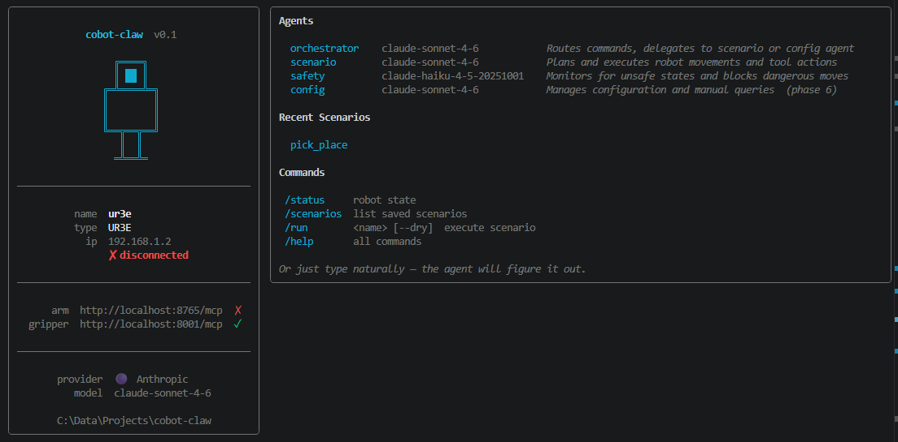
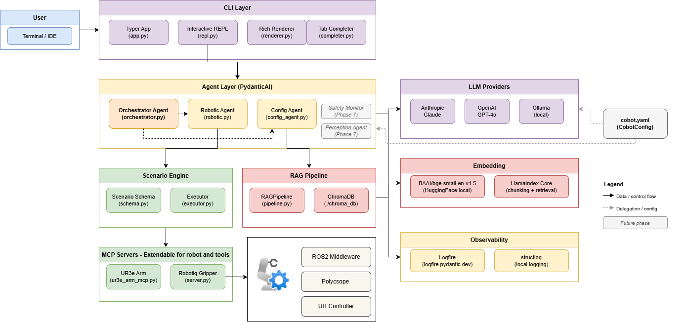
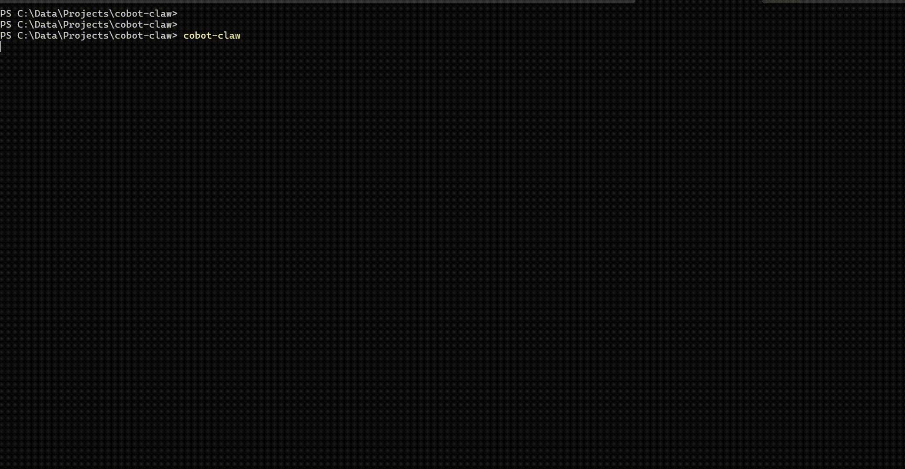
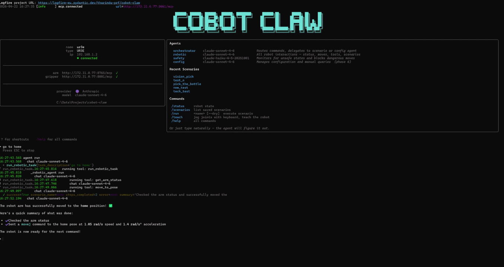
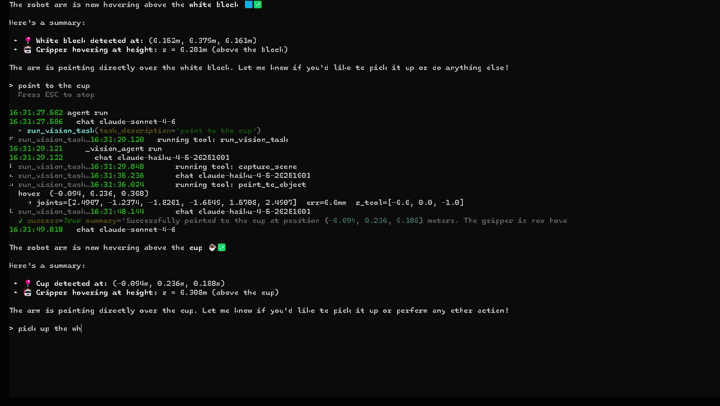

# cobot-claw

Agentic CLI for controlling UR robots via natural language — powered by local or cloud LLMs, FastMCP tool servers, and a Claude Code-style terminal interface.

---

## Preview



---

## Architecture



> Full draw.io source: [docs/architecture.drawio](docs/architecture.drawio)

---

## Overview

cobot-claw lets you command UR robot arms and end-effector tools (grippers, vacuum pumps, and more) through plain English — no programming required. Just type what you want the robot to do and the system figures out how to do it.

Under the hood, cobot-claw is a **multi-agent AI system**. Think of it as a small team of specialists, each responsible for a different part of the job:

- **Orchestrator** — the manager. Reads your request and decides which specialist to hand it to. Never calls robot hardware directly.
- **Robotic Agent** — the operator. Handles all robot interactions — status queries, movements, tool control, and scenario execution. Discovers attached tools dynamically so no code changes are needed when hardware changes.
- **Vision Agent** — the eyes. Uses an Intel RealSense camera and a vision LLM (Gemini ER or any OpenAI-compatible vision endpoint) to locate objects in 3D space, compute inverse kinematics, and execute pick, pick-and-place, and point-to operations directly — no scenario YAML needed.
- **Safety Monitor** — the supervisor. Watches the robot continuously and intervenes if anything looks dangerous.
- **Config Agent** — the technician. Answers questions from robot manuals and handles teach-by-demo scenario recording.
- **Artistic Agent** — the performer. Treats robot arm movement as artistic expression — choreography, gesture, theatre, ritual, improvisation, and installation. Invoked via `/artistic`; never auto-routed by the Orchestrator.

Each agent is powered by a large language model (LLM). cobot-claw works with **local models** running on your own hardware via [Ollama](https://ollama.com) — keeping your data private — as well as **cloud APIs** (OpenAI, Anthropic) when you need more capability. Switching between them is a one-line change in the config file.

The robot hardware is connected through lightweight **MCP servers** — small network services that expose the arm and tools as callable actions. The CLI works even when the robot is offline: the AI still responds, and you can `/reconnect` once the hardware is ready.

---

## Requirements

- Python 3.11+
- A UR robot accessible on the network (or just the gripper MCP in stub mode)
- One of:
  - [Ollama](https://ollama.com) or vLLM for local inference
  - OpenAI API key
  - Anthropic API key

---

## Installation

```bash
git clone <repo>
cd cobot-claw

# Core install
pip install -e .

# With RAG support (Phase 6+)
pip install -e ".[rag]"

# With dev/test tools
pip install -e ".[dev]"
```

---

## Configuration

Copy the example and edit before first run:

```bash
cp cobot.yaml.example cobot.yaml
```

```yaml
llm:
  # provider options: local (Ollama) | openai | anthropic
  provider: local
  base_url: http://localhost:11434/v1   # only used for provider: local
  api_key: ""                           # or set OPENAI_API_KEY / ANTHROPIC_API_KEY

fleet:
  - name: ur3e
    model_type: ur3e
    ip: 192.168.1.2
    arm_mcp_url: http://localhost:8765/mcp
    gripper_mcp_url: http://localhost:8001/mcp   # omit if no end-effector

agents:
  orchestrator:
    model: qwen2.5:72b      # or gpt-4o, claude-sonnet-4-6, etc.
  config:
    model: qwen2.5:14b
  safety:
    model: qwen2.5:7b
  vision:
    model: gemini-robotics-er-1.6-preview
    detector: gemini              # "gemini" | "openai_vision"
    google_api_key: ""            # or set GOOGLE_API_KEY env var
    ik_solver: robot              # "robot" = use arm MCP IK | "local" = analytical
    pick_x_offset_m: 0.0          # tune to correct systematic grasp X error
    pick_y_offset_m: 0.0          # tune to correct systematic grasp Y error
  artistic:
    model: claude-sonnet-4-6
    active_skills:               # any subset of the available skills
      - choreography
      - gesture
    skills_path: ./cobot/agents/artistic_agent/skills
```

### Switching to OpenAI or Anthropic

```yaml
# OpenAI
llm:
  provider: openai
  api_key: sk-...      # or export OPENAI_API_KEY
agents:
  orchestrator:
    model: gpt-4o

# Anthropic
llm:
  provider: anthropic
  api_key: sk-ant-...  # or export ANTHROPIC_API_KEY
agents:
  orchestrator:
    model: claude-sonnet-4-6
  safety:
    model: claude-haiku-4-5-20251001
```

Full schema reference: [cobot/config.py](cobot/config.py)

---

## Running

### One-command startup (recommended)

`start.sh` launches the UR ROS 2 driver, both MCP servers, and cobot-claw in the correct order with a single command:

```bash
chmod +x start.sh

./start.sh                    # uses cobot.yaml by default
./start.sh cobot.local.yaml   # pass a specific config file
```

What it does:
1. Starts the UR ROS 2 driver in the background (waits 8 s for it to come up)
2. Starts the arm MCP server in the background (ROS sourced, `ROS_DOMAIN_ID=42`)
3. Starts the gripper MCP server in the background
4. Waits 4 s for MCP servers to be ready
5. Launches `cobot-claw` in the foreground

Background process logs are written to `ur_driver.log`, `arm_mcp.log`, and `gripper_mcp.log` in the repo root. `Ctrl+C` shuts everything down cleanly.

### Manual startup

If you prefer separate terminals:

**Terminal 1 — UR ROS 2 driver:**
```bash
source /opt/ros/jazzy/setup.bash
ros2 launch ur_robot_driver ur_control.launch.py ur_type:=ur3e robot_ip:=192.168.1.2 headless_mode:=true
```

**Terminal 2 — Arm MCP server:**
```bash
source /opt/ros/jazzy/setup.bash
export ROS_DOMAIN_ID=42
python tools/ure3/ure3_arm_mcp.py
# Listening at http://0.0.0.0:8765/mcp
```

**Terminal 3 — Gripper MCP server:**
```bash
ROBOT_IP=192.168.1.2 python tools/gripper/server.py
# Listening at http://0.0.0.0:8001/mcp
```

**Terminal 4 — cobot-claw:**
```bash
cobot-claw --config cobot.yaml
```

### CLI flags

```bash
cobot-claw                            # start interactive REPL (uses cobot.yaml)
cobot-claw --config cobot.local.yaml  # use a specific config file
cobot-claw --robot ur5e               # select a specific robot from fleet
cobot-claw status                     # print robot status and exit
cobot-claw run pick_place             # execute a scenario directly
cobot-claw run pick_place --dry-run   # preview steps without moving
```

---

## CLI

### REPL Slash Commands

| Command | Description |
|---|---|
| `/status` | Robot arm state, joint state, motion info |
| `/scenarios` | List saved scenarios |
| `/run <name>` | Execute a scenario |
| `/run <name> --dry` | Preview scenario steps without moving |
| `/teach <name>` | Record arm movements and save as scenario |
| `/teach <name> --dur 60` | Teach mode with custom duration (seconds) |
| `/calibrate` | Run hand-eye calibration (moves arm through 4 poses, saves result) |
| `/calibrate --check` | Report current calibration error without saving |
| `/artistic` | Enter artistic mode — choreography, gesture, theatre, ritual |
| `/vision-debug [on\|off]` | Toggle live OpenCV camera window with detection overlays |
| `/reload-config` | Reload cobot.yaml and reconnect MCP servers |
| `/ingest [path]` | Index robot manuals into RAG knowledge base |
| `/reconnect` | Reconnect to robot MCP servers |
| `/clear` | Clear the screen |
| `/help` or `?` | Show all commands |
| `/exit` | Quit |

### Natural Language Examples

```
> move to home position
> run the pick and place sequence
> is the gripper working?
> what is the current robot state?
> open the gripper slowly

> pick the white block
> pick the bottle and place it on the brown box
> point to the red cup
> what do you see on the table?
```

The CLI shows an animated spinner while waiting for the LLM and while tool calls execute. Tool calls and results stream inline as the agent works.

### Disconnected Mode

The CLI starts even if MCP servers are unreachable. Natural language commands still work — tool calls return a clean offline message so the LLM can respond meaningfully. Use `/reconnect` to reconnect once the hardware is ready.

---

## MCP Servers

Both servers are standalone — `start.sh` manages them automatically, or start them independently.

### Arm MCP (requires ROS 2 + UR driver)

```bash
source /opt/ros/jazzy/setup.bash
export ROS_DOMAIN_ID=42
python tools/ure3/ure3_arm_mcp.py
# Listening at http://0.0.0.0:8765/mcp
```

Key tools: `get_robot_status`, `get_joint_states`, `move_joints`, `move_named_pose`, `move_tcp_pose`, `hold_position`, `recover_external_control`

### Gripper MCP (Robotiq)

```bash
ROBOT_IP=192.168.1.2 python tools/gripper/server.py
# Listening at http://0.0.0.0:8001/mcp
```

Key tools: `activate`, `open`, `close`, `move`, `stop`, `get_status`, `set_speed`, `set_force`

The gripper MCP communicates via URScript directly to TCP port 30002 — no ROS dependency. Sending URScript stops UR External Control; call `recover_external_control` on the arm MCP after any gripper command before issuing arm commands.

The Robotic Agent discovers these actions automatically via `list_tool_mcps` — replace or add any end-effector MCP without touching agent code.

---

## Vision and Hand-Eye Calibration

The Vision Agent uses an Intel RealSense camera (accessed directly via `pyrealsense2`) and a vision LLM for object detection. Before use, run hand-eye calibration to align the camera frame with the robot's TCP frame.

```
> /calibrate          # moves arm through 4 poses, computes and saves calibration
> /calibrate --check  # report reprojection error for the existing calibration
```

Calibration data is stored in `cobot/agents/vision_agent/calibration.json`. After calibration succeeds:

```
> pick the white block
> pick the bottle and place it on the brown box
> point to the red cup
> what do you see on the table?
```

Toggle the live camera debug window at any time:
```
> /vision-debug on
> /vision-debug off
```

---

## Artistic Agent

The Artistic Agent treats robot arm movement as artistic expression. It is invoked via `/artistic` and never auto-routed by the Orchestrator.

```
> /artistic
> perform a slow, contemplative greeting
> improvise a response to my presence
> perform a ritual of welcome
```

Skills define the agent's artistic disposition for a session. Available skills:

| Skill | Description |
|---|---|
| `choreography` | Structured movement sequences with compositional intent |
| `gesture` | Communicative movement directed at a person or object |
| `theatre` | Narrative arc, character, dramatic timing |
| `ritual` | Repetition, ceremony, symbolic action |
| `improvisation` | Emergent movement in response to the environment |
| `installation` | Continuous, ambient movement for unattended spaces |
| `collaborative` | Co-authorship — pauses to invite human contribution |

Configure active skills in `cobot.yaml`:

```yaml
agents:
  artistic:
    model: claude-sonnet-4-6
    active_skills:
      - choreography
      - gesture
      - improvisation
```

New skills require only a new `.md` file in `cobot/agents/artistic_agent/skills/` and a config entry — no code changes.

The Artistic Agent uses the Vision Agent (`observe_space`) to detect audience presence and respond to spatial context during improvisation and installation performances.

---

## Scenarios

Predefined scenarios are YAML files in `cobot/scenarios/store/`. The executor runs them deterministically — no LLM is invoked during execution.

```yaml
# cobot/scenarios/store/pick_place.yaml
name: pick-place-box
robot: ur3e
steps:
  - type: move_named_pose
    pose: home
  - type: move_tcp_pose
    x: 0.30
    y: 0.10
    z: 0.20
    perception:
      locate: "red_box"
    fallback_position:
      x: 0.30
      y: 0.10
      z: 0.20
  - type: tool_action
    tool: gripper
    action: close
    params: {speed: 50, force: 60}
    arm_recovery_sec: 6.0         # wait for UR External Control to restore
  - type: move_named_pose
    pose: home
```

Supported step types: `move_named_pose`, `move_joints`, `move_tcp_pose`, `tool_action`, `wait`, `check_motion_complete`, `repeat`.

`arm_recovery_sec` on `tool_action` steps is critical when using a Robotiq gripper — the gripper script interrupts UR External Control, and the executor polls `get_robot_status` until `ros_ready=True` before continuing.

---

## Manual Q&A and Teach Mode

Ask natural language questions about your robot, or record arm movements directly from the REPL.

### Setup

```bash
pip install -e ".[rag]"

# Place PDF/TXT/MD manuals in ./manuals, then index them:
cobot-claw ingest --path ./manuals

# Or inside the REPL:
> /ingest ./manuals
```

### Manual Q&A

Once indexed, ask questions in plain English:

```
> what is the max payload for the ur3e?
> how do I set the TCP offset?
> what does error code 53 mean?
```

The Config Agent searches the indexed manuals and returns grounded answers.

### Teach Mode

Record waypoints while the robot arm is in **freedrive**:

```
> /teach my_motion
> /teach pick_sequence --dur 60
```

The REPL prompts you to enable freedrive on the pendant, then records joint states for the specified duration (default 30 s). The motion is automatically saved as a scenario YAML in `cobot/scenarios/store/` — ready to run with `/run my_motion`.

You can also ask conversationally:

```
> record a new picking motion called box_pick
> teach me a new scenario for 45 seconds
```

---

## Project Structure

```
cobot-claw/
├── cobot.yaml                        # Fleet, LLM, agent config
├── start.sh                          # One-command launcher (driver + MCPs + CLI)
├── pyproject.toml
├── docs/
│   └── claw_welcome.png              # Welcome screen preview
├── cobot/
│   ├── config.py                     # Pydantic config schema + loader
│   ├── llm.py                        # LLM client factory (local / OpenAI / Anthropic)
│   ├── logging.py                    # structlog setup
│   ├── mcp/
│   │   ├── client.py                 # Async MCPClient (streamable-http)
│   │   └── perception_contract.py    # PerceptionClient stub
│   ├── scenarios/
│   │   ├── schema.py                 # Pydantic step types + discriminated union
│   │   ├── executor.py               # Deterministic scenario executor
│   │   └── store/                    # Saved scenario YAMLs
│   ├── agents/
│   │   ├── deps.py                   # Shared deps dataclasses
│   │   ├── robotic_agent.py          # Robotic Agent (dynamic tool discovery)
│   │   ├── config_agent.py           # Config Agent (RAG + teach mode)
│   │   ├── orchestrator.py           # Orchestrator Agent
│   │   ├── vision_agent/
│   │   │   ├── agent.py              # Vision Agent tools (pick, pick-and-place, point)
│   │   │   ├── camera.py             # RealSense capture + depth utilities
│   │   │   ├── calibrate.py          # Hand-eye calibration (4-pose routine)
│   │   │   ├── detector.py           # VisionDetector protocol + Gemini/OpenAI backends
│   │   │   ├── kinematics.py         # UR3e analytical IK + robot MCP IK with fallback
│   │   │   ├── scenario.py           # Vision-guided scenario YAML generator
│   │   │   └── calibration.json      # Saved hand-eye calibration
│   │   └── artistic_agent/
│   │       ├── agent.py              # Artistic Agent (movement as expression)
│   │       ├── deps.py               # ArtisticAgentDeps
│   │       ├── interpret.py          # Cultural/emotional interpretation sub-agent
│   │       └── skills/               # Skill definition .md files
│   │           ├── choreography.md
│   │           ├── gesture.md
│   │           ├── theatre.md
│   │           ├── ritual.md
│   │           ├── improvisation.md
│   │           ├── installation.md
│   │           └── collaborative.md
│   ├── cli/
│   │   ├── app.py                    # Typer entry point (cobot-claw command)
│   │   ├── repl.py                   # Interactive REPL loop + agent streaming
│   │   ├── renderer.py               # Rich welcome screen, tool call display
│   │   ├── session.py                # CobotSession dataclass
│   │   ├── completer.py              # Tab completion for slash commands + scenarios
│   │   └── commands/
│   │       ├── status.py             # /status command
│   │       ├── scenario.py           # /run, /scenarios commands
│   │       ├── calibrate.py          # /calibrate command
│   │       └── artistic.py           # /artistic command
│   └── rag/
│       └── pipeline.py               # RAGPipeline (ChromaDB + LlamaIndex)
├── tools/
│   ├── ure3/
│   │   └── ure3_arm_mcp.py           # UR3e arm MCP server (FastMCP + ROS2)
│   └── gripper/
│       ├── server.py                 # Robotiq gripper MCP server
│       ├── robotiq_driver.py         # Low-level URScript driver
│       └── Gripper.script            # URScript template
├── tests/                            # pytest suite
└── scripts/
    ├── check_phase1.py
    └── check_phase2.py
```

---

## Verification

```bash
# Phase 1 — config, schema, LLM client (no robot needed)
python scripts/check_phase1.py

# Phase 2 — MCP client + perception stub (no robot needed)
python scripts/check_phase2.py

# Phase 2 with live MCP servers
python scripts/check_phase2.py --live

# Full test suite
pytest
pytest -v
```

---

## Implementation Phases

| Phase | Deliverable | Status |
|---|---|---|
| 1 | Config schema, LLM client, logging | **Done** |
| 2 | MCP client wrapper, perception contract stub | **Done** |
| 3 | Scenario schema, executor, example YAML, RAG stub | **Done** |
| 4 | Robotic Agent + Config Agent + Orchestrator Agent | **Done** |
| 5 | CLI — REPL, slash commands, streaming output | **Done** |
| 6 | Config Agent RAG + `/teach` (real ChromaDB/LlamaIndex) | **Done** |
| 7 | Vision Agent — RealSense + Gemini ER + analytical IK + pick/place | **Done** |
| 8 | Artistic Agent — movement as expression, skill system, cultural interpretation | **Done** |
| 9 | Safety Monitor | Future |

Full implementation details: [IMPLEMENTATION_PLAN.md](IMPLEMENTATION_PLAN.md)

---

## Tech Stack

| Layer | Library |
|---|---|
| Agent framework | [PydanticAI](https://ai.pydantic.dev) |
| LLM providers | OpenAI SDK (local/OpenAI/Anthropic via provider config) |
| MCP servers | [FastMCP](https://github.com/jlowin/fastmcp) |
| Config schema | Pydantic v2 |
| Scenario schema | Pydantic v2 discriminated union |
| CLI | Typer + Rich + prompt_toolkit |
| RAG | LlamaIndex + ChromaDB |
| Vision / detection | Gemini Robotics ER · OpenAI-compatible vision endpoints |
| Depth sensing | Intel RealSense (pyrealsense2) |
| Robot kinematics | Closed-form analytical IK + UR controller MCP IK |
| Logging | structlog |
| Tests | pytest + pytest-asyncio |

---

## Demo






